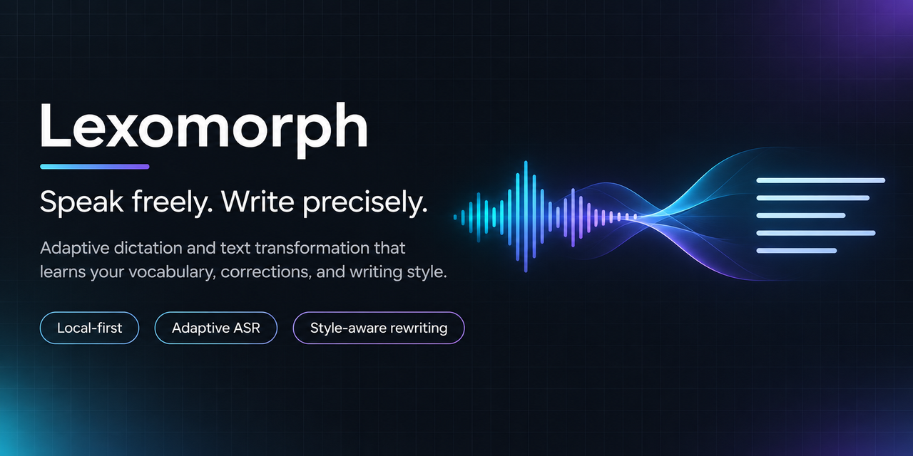
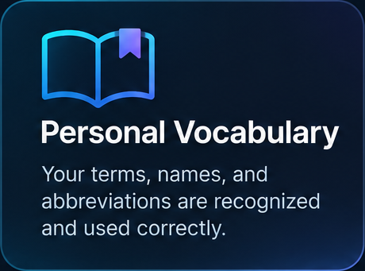
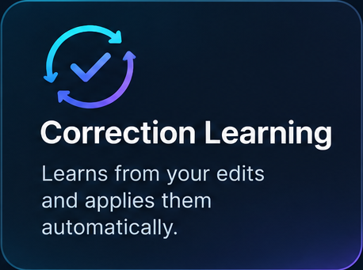
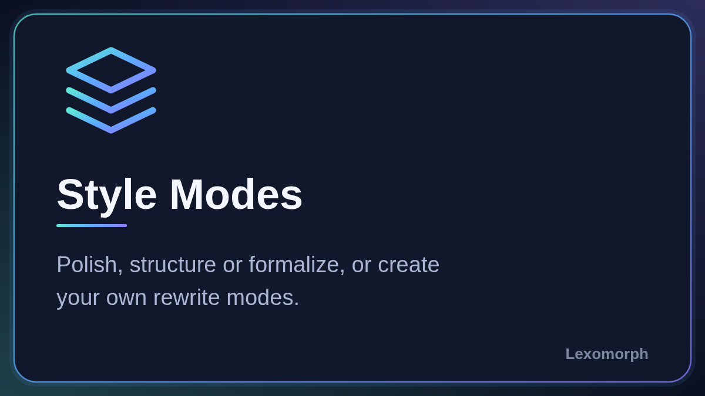

<div align="center">
  
</div>

# Lexomorph

**Speak freely. Write precisely.**

[](LICENSE)
[](#supported-platforms)
[](https://github.com/shohart/SuperDictate-Next/releases)

Lexomorph is a personal adaptive writing engine for macOS and Windows. It
combines speech recognition with language-specific correction, a personal
vocabulary and configurable writing modes, helping you turn spoken thoughts
into text that matches the way you want to write. Hold a hotkey, speak, and
the text is typed into whatever field is focused.

> **Lexomorph is the new name of SuperDictate Next.** Same project, a broader
> vision: from speech recognition to adaptive, personal writing. The
> repository, the releases, the installer and the data on your disk keep their
> old names on purpose, so that existing installations keep working and
> updating. See [Compatibility: names that stayed](#compatibility-names-that-stayed).

**[Читать по-русски](README.ru.md)**

## Highlights

- **Speech recognition on your own machine.** Audio is recognized locally by
  Parakeet Ultra 0.6B or GigaAM v3 (ONNX Runtime, CPU). Audio is never sent
  anywhere.
- **A personal vocabulary.** Replacement rules for names, terms and spellings,
  plus a list of terms that is passed to the recognizer as hints.
- **Corrections you make are remembered.** Fix a short word right after it is
  typed and the app offers to remember the fix, with an undo.
- **Writing modes.** Optional LLM correction and rewrite: Polish, Structured
  task, Official and your own modes. Run on a local model or on an
  OpenAI-compatible endpoint you choose. Off by default.
- **Honest about the network.** [One table](#privacy-and-backends) lists what
  stays on the device and what can leave it.
- **macOS and Windows,** Apple Silicon and Intel.

## How it works

```
microphone
  -> pause segmentation (Silero VAD), overlapping windows, seam deduplication
  -> speech recognition: Parakeet Ultra or GigaAM v3, in a separate helper process
       (your ASR terms are passed to the decoder as hints, before any text step)
  -> rules: your replacement dictionary, filler words, Russian numbers as digits
  -> optional LLM correction     (off by default)
  -> optional rewrite by mode    (off by default)
  -> optional punctuation        (off by default; the last step)
  -> text inserted into the focused field
```

This is the order the code and the changelog describe. Individual modes can
skip steps; for example, correction and rewrite are separate switches, and each
can use its own backend.

## Supported platforms

| Platform | Requirements | How you get it |
|---|---|---|
| macOS | macOS 14 or newer, Apple Silicon or Intel. Verified by hand on one Intel machine; CI runs on Apple Silicon only. | One-line installer (below). The published `Lexomorph.zip` is built for **Intel (x86_64)**; on Apple Silicon, build from source with the same installer. |
| Windows | Windows 10 version 1809 (build 17763) or newer, 64-bit. Per-user install, no administrator rights needed. | `SuperDictate-X.Y.Z-setup.exe` from a `win-v*` entry on the [Releases page](https://github.com/shohart/SuperDictate-Next/releases). There is no Windows CI; Windows builds are checked by hand. |

Linux is not supported. On Intel laptops with an NPU, the Windows version can
also recognize speech on the NPU (OpenVINO); see [windows/README.md](windows/README.md).

## Privacy and backends

Audio never leaves the device. Text can leave it only through the options you
turn on. Nothing here is "offline by default": the first run downloads models.

| Data or network use | Where it goes | When | What is sent | Credentials | Default |
|---|---|---|---|---|---|
| Your voice (audio) | nowhere | never; recognition is local | none | none | n/a |
| Speech and punctuation models | huggingface.co (pinned revisions, SHA-256 checked) | first run, or when you pick another model | a file request | none | on first run |
| Silero VAD file | huggingface.co (`ggml-org/whisper-vad`) | automatically after the speech model loads | a file request | none | on |
| Local LLM models | the pinned model catalog; the correction adapter is fetched from this repository on GitHub | when you press download | a file request | none | not downloaded |
| Update check | api.github.com, raw.githubusercontent.com | macOS: when you open the panel, plus a background check if you enable it. Windows: automatic by default | a request for the release list | none | macOS: panel only; Windows: on |
| LLM correction or rewrite on **your own endpoint** | the URL you enter (the field suggests OpenRouter) | only if you pick the custom endpoint | **the dictated text** and the instruction prompt; no audio | your API key, stored **as plain text** in the settings (macOS UserDefaults, Windows `Settings.json`) | off; the default backend is the local model |
| Account sync of vocabulary and ASR terms | the sync server run by the project owner (`superdictate.bykovlegal.ru`; source in [server/vocab-sync](server/vocab-sync)) | only after you sign in | replacement rules (source, replacement, origin, ASR-hint flag) and ASR terms; in this branch, also your custom mode names, colors and instructions and per-day usage counters | e-mail and password; the token is kept in the macOS Keychain or Windows DPAPI | off |
| History, settings, diagnostics | your disk only | always | stays on the device | none | on |
| Analytics and telemetry | none in the code | n/a | n/a | n/a | n/a |

Where the records live (paths keep the old name, see
[below](#compatibility-names-that-stayed)):

- macOS: `~/Library/Application Support/Lexomorph` (history, settings,
  `corrections.sqlite`, models), `~/Library/Logs/Lexomorph-*`, and the
  LaunchAgent `~/Library/LaunchAgents/com.local.lexomorph.agent.plist`.
- Windows: `%LOCALAPPDATA%\SuperDictate`.
- History keeps the dictated text. `DictationTrace.jsonl` records, for the last
  2000 to 4000 dictations, what recognition wrote, the text after the rules and
  the final text. It stays on your computer; delete it if you do not want it.
- A recording that was interrupted by a crash is kept as audio for recovery
  and removed after it is handled.

Sync is opt-in and is the only thing that needs an account. More details:
[PRIVACY.md](PRIVACY.md).

## Installation

### macOS

Open Terminal, paste, press Enter:

```bash
curl -fsSL https://raw.githubusercontent.com/shohart/SuperDictate-Next/main/install.sh | /bin/bash
```

The installer downloads `Lexomorph.zip` from
[GitHub Releases](https://github.com/shohart/SuperDictate-Next/releases),
verifies a pinned SHA-256, the version, the bundle ID, the architecture, the
code signature and the microphone entitlements, then replaces
`/Applications/Lexomorph.app` and opens it. Xcode is not needed. Your
history, settings and downloaded models are kept.

Release builds are signed with a developer certificate ("PolterType Dev") and
are **not notarized by Apple**. The installer path above is verified, but a ZIP
downloaded through a browser can trigger a Gatekeeper warning. Local builds made
with `scripts/build-app.sh` are signed ad-hoc unless you pass `SIGN_IDENTITY`.

**Apple Silicon:** the published ZIP is Intel-only and the installer will refuse
it. Build from source with the same script:

```bash
curl -fsSL https://raw.githubusercontent.com/shohart/SuperDictate-Next/main/install.sh | LEXOMORPH_BUILD_FROM_SOURCE=1 /bin/bash
```

This needs the free Apple Command Line Tools; if they are missing, the
installer opens Apple's dialog and you run the command again. A clean first
build takes a few minutes. By default it downloads the pinned release source
commit and verifies it against GitHub.

### Windows

Download `SuperDictate-X.Y.Z-setup.exe` from the newest `win-v*` entry on the
[Releases page](https://github.com/shohart/SuperDictate-Next/releases) and run
it. Windows releases are never marked "latest", so the badge above and the
"latest" link show the macOS release. The app is installed for the current user.

### Updating

- **macOS, from the app:** open the app from Applications and click `Update`
  when it appears. The app downloads the new build, verifies the checksum, bundle
  ID, version and signature, replaces itself and relaunches. The panel
  checks when opened; the automatic background check is **off by default** on
  macOS and can be enabled in the settings.
- **macOS, from Terminal:** run the install command again. It replaces only
  `/Applications/Lexomorph.app`.
- **Windows:** the app checks for updates by default (can be turned off) and
  opens the release page when a newer `win-v*` exists. It does not download or
  run anything by itself; you run the new `setup.exe`.

### Uninstalling

```bash
curl -fsSL https://raw.githubusercontent.com/shohart/SuperDictate-Next/main/uninstall.sh | bash
```

Removes the app and the background service. History, settings and models are
kept so that a reinstall does not lose data or redownload the model. On Windows,
use "Apps and features".

## Quick start

1. Install (above). On the first macOS launch, click `Allow` for **Microphone**,
   **Accessibility** and **Input Monitoring**.
2. Wait while the speech model downloads once (Parakeet Ultra 0.6B, ONNX int8):
   about 630 MB on disk, and about 1.5 GB of free space during installation.
3. When the status reads `Ready`, press **right Command** (macOS) or **right
   Ctrl** (Windows), speak, and press the same key again. The text is inserted.

Hotkeys on macOS (all rebindable in Settings; single keys, function keys,
combinations and modifier-only chords work, and left and right modifiers are
distinct):

| Action | Default |
|---|---|
| Start, then insert | right Command |
| Stop the other way (insert + Enter, or without it) | right Option + right Command |
| Open the quick history | right Shift + right Command |

Windows defaults are in [windows/README.md](windows/README.md).

## Configuration

The control panel shows the background service, missing permissions and
updates. The gear opens Settings:

- **Dictation:** the three hotkeys and what the second press does.
- **Text:** filler words, Russian numbers as digits, vocabulary learning,
  correction and rewrite settings.
- **Audio:** microphone, auto-stop on silence (1 to 10 s, optional), mute while
  recording.
- **Appearance:** capsule size, colors, indicator mode.
- **System:** launch at login, privacy information.

`RU / EN` switches the interface language. Changes are a draft until
`Save and Restart`, which restarts only the background service. The panel can be
closed; the service keeps running and starts after the next login.

Filler words (`um`, `uh`, `эм`, and others) have 27 curated presets plus your
own words and phrases; the verbal-tic phrases are off until you tick them.

## Personalization

What actually happens today. Nothing is trained on your device or on your data:
there is no fine-tuning of the recognizer or the language model, and no
adaptation to your voice.

| Mechanism | What it does | Notes |
|---|---|---|
| Replacement dictionary | Rules "heard text -> written text" applied after recognition. Add, edit, delete by hand; JSON import and export. | Local SQLite file. Cleanup tool shows a preview of merges and removals. |
| Learning from your edits | If you fix a short word or phrase (up to three words) right after it was inserted, the app saves a rule and shows a toast; **Esc** undoes it. | On by default, can be turned off. Heuristic: case-ending changes, meaning changes and pure punctuation or casing edits are ignored. Not machine learning. |
| ASR terms (hotwords) | Names and terms from the dictionary and your own list are passed to the decoder as hints, so it spells them correctly more often. | On by default. A hint, not a guarantee. They never replace text on their own. |
| Writing modes | Instructions to an LLM that reshape the text. | Off by default. See below. |
| Correction guard | When the LLM changes a word, the change is compared with the original; unrelated replacements are reverted, and words from your vocabulary are protected. | Part of LLM correction. |

You can review, edit and delete everything the app remembers in Settings > Text
(the vocabulary manager).

<p align="center">
  
  
  
</p>

*Concept illustrations, not screenshots. In the app, the vocabulary works as
described above and is a nudge, not a promise of perfect spelling; learning is
limited to short edits; modes need an LLM (local or your endpoint) and are off by
default.*

## Writing modes

Correction and rewrite are two independent, optional stages. Each can use the
bundled local model (llama.cpp, CPU or Vulkan GPU) or an OpenAI-compatible
endpoint you configure.

| Mode | Does |
|---|---|
| Correction | Fixes recognition mistakes, case and punctuation, and restores Latin spelling of English terms. Off by default. |
| Polish | Removes repeats and clutter, keeps your wording and style. |
| Structured task | Expands a spoken request into a structured task description. |
| Official | Turns text into a formal, business register. |
| Custom modes | Your own name, color, instruction and hotkey. |

Rewrite is off by default. With a custom endpoint, the dictated text and the instruction are sent to
that server, so they leave the device.

## Sync

| What | Status |
|---|---|
| Replacement dictionary and ASR terms between your Macs (one JSON file in a folder you choose, for example iCloud, Dropbox or Syncthing; no account) | released (macOS) |
| Dictionary and ASR terms between macOS and Windows, through an account (e-mail and password) on the sync server | released: dictionary in 0.9.3, ASR terms in 0.9.5; off until you sign in |
| Custom writing modes (name, color, instruction) and dictation statistics per day and device | **unreleased: exists only in this branch, no release contains it yet** |
| Settings, hotkeys, the active mode | not synced (hotkeys and the active mode are intentionally local) |
| Mobile devices | no client exists |

## Screenshots

> **TODO: real screenshot.** No application screenshot is included yet. A real
> one, free of private text, will replace this note. The images in this README
> are brand illustrations, not screenshots of the app.

## Architecture

- **macOS:** Swift and AppKit, SwiftPM package in [swift/](swift); recognition in
  the helper process `LexomorphOnnxHost` (C++ core in
  [native/asr-runtime](native/asr-runtime), ONNX Runtime 1.23.2, CPU); LLM in
  `LexomorphLLMHost` (llama.cpp, loopback HTTP).
- **Windows:** Python and PySide6 in [windows/](windows), the same ONNX host.
- **Sync server:** FastAPI and SQLite in [server/vocab-sync](server/vocab-sync).
- Specs: [docs/specs](docs/specs). Release process: [docs/RELEASING.md](docs/RELEASING.md).

### Speech recognition: why CPU

Measured through the app's real dictation path (pause segmentation, overlapping
windows, seam deduplication), 8 clips of 1.7 to 52 s, 8 threads, no LLM, on a
reference Intel Mac (Xeon E5-2696 v3, AMD Radeon Vega):

| Engine | Mean WER | Mean punctuation F1 | Mean RTF | Load, s |
|---|---:|---:|---:|---:|
| **ONNX, CPU** | **0.079** | **0.965** | **0.119** | 3.7 |
| parakeet.cpp GGUF q8_0, CPU | 0.084 | 0.909 | 0.182 | 5.5 |
| parakeet.cpp GGUF q8_0, Vulkan | 0.084 | 0.909 | 0.133 | 6.0 |
| whisper.cpp large-v3-turbo q8_0, Vulkan | not scored | not scored | 0.63 to 6.4 | 17 |

The GGUF and Whisper engines were removed on 2026-10-17; details in
`docs/specs/cross-platform-onnx-asr-spec.md` section 12. Long dictations are cut
at pauses and the seams are placed with
[Silero VAD](https://github.com/snakers4/silero-vad) (ggml build, 885 KB, MIT,
downloaded in the background; without it a mel-energy heuristic is used).

## Building from source

Manual build for development (macOS):

```bash
xcode-select --install
git clone https://github.com/shohart/SuperDictate-Next.git
cd SuperDictate-Next
swift run -c debug --package-path swift Lexomorph --self-test all
./scripts/build-app.sh ./dist/Lexomorph.app
```

Do not launch the copied or test bundle. The only runnable installed bundle is
`/Applications/Lexomorph.app`; for local installation use
`scripts/install-local.sh`. `--self-test` can stop the production background
agent; check that it is running afterwards. Windows: see
[windows/README.md](windows/README.md).

## Troubleshooting

- **The status never becomes `Ready` after granting permissions.** Open the app
  and click `Restart` on the background service. If the app is missing from the
  system list, click `Try Again` next to that permission.
- **Where do I find the app in macOS Privacy settings?** It is listed as
  **SuperDictate**, not Lexomorph: macOS takes the name from the app file, which
  keeps its old name on purpose.
- **The installer says the build is not for this Mac.** You are on Apple
  Silicon: use the build-from-source command.
- **A browser-downloaded ZIP shows a Gatekeeper warning.** The build is not
  notarized; use the Terminal installer.
- **macOS asks for permissions again after an update.** Release builds are
  signed with a local developer certificate, not notarized; re-grant if prompted.
- **Text is not inserted in some fields.** Protected password fields and apps
  that hide Accessibility data may not expose the caret; that can affect the
  animation position and sometimes insertion.
- **A recording stops by itself.** A single recording ends after 20 minutes. If
  the app crashes, an unfinished recording is saved for recovery from history.
- **Model download fails.** The first run needs internet access to huggingface.co.
- **Resource use:** the speech model is about 630 MB on disk; the ONNX helper
  peaks at about 2.2 GB resident (mapped model pages included); the app process
  stays around 40 to 60 MB.

Logs: `~/Library/Logs/Lexomorph-*` on macOS, `%LOCALAPPDATA%\SuperDictate` on
Windows. Do not paste transcripts or audio into public issues.

## Compatibility: names that stayed

Since 0.10.0 the macOS identifiers carry the new name too: `/Applications/Lexomorph.app`,
bundle ID `com.local.lexomorph`, LaunchAgent `com.local.lexomorph.agent`, data and
log paths, the `Lexomorph.zip` asset, the `LEXOMORPH_*` variables and the SwiftPM
target `Lexomorph`. Because macOS sees a new app, grant the Microphone,
Accessibility and Input Monitoring permissions again; on first launch your
settings, vocabulary and models are carried over, and the old SuperDictate data
is left untouched for rollback. Still named SuperDictate on purpose: the
repository `shohart/SuperDictate-Next`, the sync server address, and the
Windows build (`SuperDictate-X.Y.Z-setup.exe`, `%LOCALAPPDATA%\SuperDictate`).
Details and reasons: [docs/branding/MIGRATION_NOTES.md](docs/branding/MIGRATION_NOTES.md).
Brand rules: [docs/branding/BRAND_GUIDELINES.md](docs/branding/BRAND_GUIDELINES.md).

## Contributing

Issues and pull requests are welcome: [CONTRIBUTING.md](CONTRIBUTING.md) lists
the checks, and [CODE_OF_CONDUCT.md](CODE_OF_CONDUCT.md) the community rules.
Checks before a pull request:

```bash
./scripts/check.sh
swift run -c debug --package-path swift Lexomorph --self-test all
./scripts/build-app.sh ./dist/Lexomorph.app
```

## License and credits

MIT, see [LICENSE](LICENSE) and [NOTICE.md](NOTICE.md).

Lexomorph (formerly SuperDictate Next, and before that SuperDictate-Intel) is a
fork of [SuperDictate](https://github.com/shlgd/SuperDictate), which is based on
the open-source [Parakey](https://github.com/rcourtman/parakey) project by
Richard Courtman. The name changed from SuperDictate-Intel to SuperDictate Next
with v0.5.0. The rename to Lexomorph is not part of any release yet (the latest
release is 0.9.7). Old repository URLs redirect. The brand has not been checked for trademark or domain availability.
