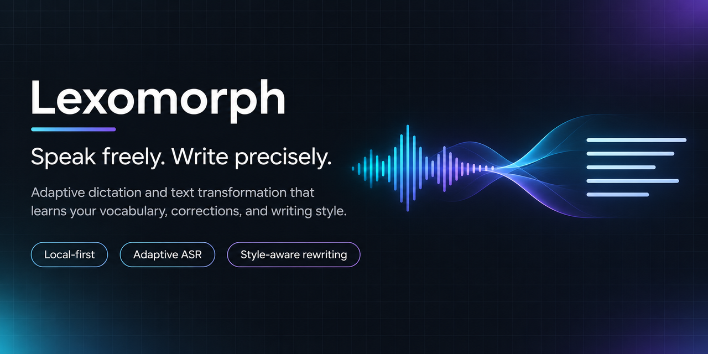
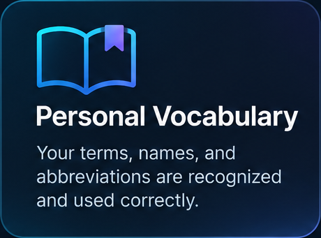
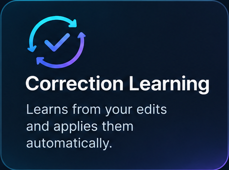
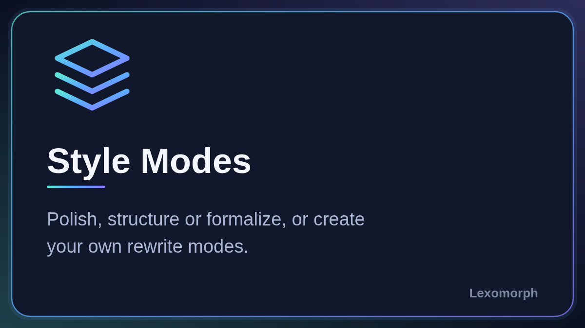

<div align="center">
  
</div>

# Lexomorph

**Speak freely. Write precisely.**

[](LICENSE)
[](#поддерживаемые-платформы)
[](https://github.com/shohart/SuperDictate-Next/releases)

Lexomorph — персональный адаптивный движок письма для macOS и Windows. Он
соединяет распознавание речи с языковой коррекцией, личным словарём и
настраиваемыми режимами письма, чтобы устная мысль превращалась в текст так,
как вы хотите его писать. Зажмите горячую клавишу, говорите — текст
печатается в активном поле.

> **Lexomorph — новое название SuperDictate Next.** Тот же проект, более
> широкая идея: от распознавания речи к адаптивному персональному письму.
> Репозиторий, релизы, установщик и данные на диске намеренно сохраняют
> старые имена, чтобы уже установленные копии работали и обновлялись. См.
> [Совместимость: имена, которые остались](#совместимость-имена-которые-остались).

**[Read this in English](README.md)**

## Главное

- **Распознавание речи на вашем компьютере.** Аудио распознаёт локально
  Parakeet Ultra 0.6B или GigaAM v3 (ONNX Runtime, CPU). Аудио никуда не
  отправляется.
- **Личный словарь.** Правила замены для имён, терминов и написаний, плюс
  список терминов, который передаётся распознавателю как подсказки.
- **Ваши исправления запоминаются.** Поправьте короткое слово сразу после
  вставки — приложение предложит запомнить правку, с отменой.
- **Режимы письма.** Необязательные LLM-коррекция и рерайт: Polish,
  Structured task, Official и ваши режимы. Работают на локальной модели или на
  OpenAI-совместимом endpoint по вашему выбору. По умолчанию выключены.
- **Честно про сеть.** [Одна таблица](#приватность-и-бэкенды) показывает, что
  остаётся на устройстве, а что может его покинуть.
- **macOS и Windows**, Apple Silicon и Intel.

## Как это работает

```
микрофон
  -> сегментация по паузам (Silero VAD), перекрывающиеся окна, дедупликация швов
  -> распознавание: Parakeet Ultra или GigaAM v3, в отдельном процессе-хосте
       (ваши ASR-термины передаются декодеру как подсказки, до любых текстовых этапов)
  -> правила: словарь замен, слова-паразиты, русские числа цифрами
  -> опционально: LLM-коррекция   (по умолчанию выкл.)
  -> опционально: рерайт по режиму (по умолчанию выкл.)
  -> опционально: пунктуация       (по умолчанию выкл.; последний этап)
  -> вставка текста в активное поле
```

Так порядок описан в коде и в журнале изменений. Отдельные режимы могут
пропускать этапы: коррекция и рерайт включаются независимо, и у каждого может
быть свой бэкенд.

## Поддерживаемые платформы

| Платформа | Требования | Как получить |
|---|---|---|
| macOS | macOS 14 и новее, Apple Silicon или Intel. Проверено вручную на одной Intel-машине; CI работает только на Apple Silicon. | Установка одной командой (ниже). Опубликованный `Lexomorph.zip` собран под **Intel (x86_64)**; на Apple Silicon собирайте из исходников тем же установщиком. |
| Windows | Windows 10 версии 1809 (сборка 17763) и новее, 64-разрядная. Установка для текущего пользователя, права администратора не нужны. | `SuperDictate-X.Y.Z-setup.exe` из записи `win-v*` на [странице релизов](https://github.com/shohart/SuperDictate-Next/releases). CI для Windows нет; сборки проверяются вручную. |

Linux не поддерживается. На ноутбуках Intel с NPU версия для Windows умеет
распознавать речь и на NPU (OpenVINO), см. [windows/README.md](windows/README.md).

## Приватность и бэкенды

Аудио никогда не покидает устройство. Текст может его покинуть только через
опции, которые вы включаете сами. «Полностью офлайн по умолчанию» здесь не
подходит: первый запуск скачивает модели.

| Данные или сетевое обращение | Куда | Когда | Что передаётся | Учётные данные | По умолчанию |
|---|---|---|---|---|---|
| Ваш голос (аудио) | никуда | никогда; распознавание локальное | ничего | нет | — |
| Модели речи и пунктуации | huggingface.co (закреплённые ревизии, проверка SHA-256) | первый запуск или выбор другой модели | запрос файла | нет | при первом запуске |
| Файл Silero VAD | huggingface.co (`ggml-org/whisper-vad`) | автоматически после загрузки речевой модели | запрос файла | нет | вкл. |
| Локальные LLM-модели | закреплённый каталог моделей; адаптер коррекции берётся из этого репозитория на GitHub | по кнопке загрузки | запрос файла | нет | не скачаны |
| Проверка обновлений | api.github.com, raw.githubusercontent.com | macOS: при открытии панели и фоновая проверка, если включить. Windows: автоматически по умолчанию | запрос списка релизов | нет | macOS: только панель; Windows: вкл. |
| LLM-коррекция или рерайт на **вашем endpoint** | URL, который вы укажете (в поле подсказка OpenRouter) | только если выбран свой endpoint | **диктуемый текст** и инструкция; аудио нет | ваш API-ключ, хранится **открытым текстом** в настройках (macOS UserDefaults, Windows `Settings.json`) | выкл.; бэкенд по умолчанию — локальная модель |
| Синхронизация словаря и ASR-терминов через аккаунт | сервер синхронизации владельца проекта (`superdictate.bykovlegal.ru`; код в [server/vocab-sync](server/vocab-sync)) | только после входа в аккаунт | правила замены (исходный текст, замена, происхождение, флаг ASR-подсказки) и ASR-термины; в этой ветке также имена, цвета и инструкции ваших режимов и счётчики использования по дням | e-mail и пароль; токен хранится в Keychain macOS или DPAPI Windows | выкл. |
| История, настройки, диагностика | только ваш диск | всегда | остаётся на устройстве | нет | вкл. |
| Аналитика и телеметрия | в коде нет | — | — | — | — |

Где лежат записи (пути сохраняют старое имя, см.
[ниже](#совместимость-имена-которые-остались)):

- macOS: `~/Library/Application Support/Lexomorph` (история, настройки,
  `corrections.sqlite`, модели), `~/Library/Logs/Lexomorph-*` и LaunchAgent
  `~/Library/LaunchAgents/com.local.lexomorph.agent.plist`.
- Windows: `%LOCALAPPDATA%\SuperDictate`.
- История хранит диктуемый текст. `DictationTrace.jsonl` для последних 2000–4000
  диктовок записывает, что выдало распознавание, текст после правил и итоговый
  текст. Файл остаётся на вашем компьютере; удалите его, если он не нужен.
- Запись, прерванная сбоем, хранится как аудио для восстановления и удаляется
  после обработки.

Синхронизация необязательна и единственная требует аккаунта. Подробнее:
[PRIVACY.md](PRIVACY.md).

## Установка

### macOS

Откройте Terminal, вставьте и нажмите Enter:

```bash
curl -fsSL https://raw.githubusercontent.com/shohart/SuperDictate-Next/main/install.sh | /bin/bash
```

Установщик скачивает `Lexomorph.zip` из
[GitHub Releases](https://github.com/shohart/SuperDictate-Next/releases),
проверяет закреплённую SHA-256, версию, bundle ID, архитектуру, подпись кода и
права на микрофон, затем заменяет `/Applications/Lexomorph.app` и открывает
приложение. Xcode не нужен. История, настройки и скачанные модели сохраняются.

Релизные сборки подписаны сертификатом разработчика («PolterType Dev») и **не
нотаризованы Apple**. Установка этой командой проверяется, но ZIP, скачанный
через браузер, может вызвать предупреждение Gatekeeper. Локальные сборки
`scripts/build-app.sh` подписываются ad-hoc, если не передан `SIGN_IDENTITY`.

**Apple Silicon:** опубликованный ZIP только для Intel, установщик его
отклонит. Соберите из исходников тем же скриптом:

```bash
curl -fsSL https://raw.githubusercontent.com/shohart/SuperDictate-Next/main/install.sh | LEXOMORPH_BUILD_FROM_SOURCE=1 /bin/bash
```

Нужны бесплатные Command Line Tools от Apple; если их нет, установщик откроет
окно установки Apple, и команду нужно запустить снова. Первая чистая сборка
занимает несколько минут. По умолчанию скачивается закреплённый исходный
коммит релиза, который сверяется с GitHub.

### Windows

Скачайте `SuperDictate-X.Y.Z-setup.exe` из самой новой записи `win-v*` на
[странице релизов](https://github.com/shohart/SuperDictate-Next/releases) и
запустите. Релизы Windows никогда не помечаются «latest», поэтому бейдж выше и
ссылка «latest» показывают релиз macOS. Приложение ставится для текущего
пользователя.

### Обновление

- **macOS, из приложения:** откройте приложение из Applications и нажмите
  `Update`, когда кнопка появится. Приложение скачает сборку, проверит сумму,
  bundle ID, версию и подпись, заменит себя и перезапустится. Панель проверяет
  обновления при открытии; автоматическая фоновая проверка **по умолчанию
  выключена** и включается в настройках.
- **macOS, из Terminal:** снова выполните команду установки. Она заменяет только
  `/Applications/Lexomorph.app`.
- **Windows:** приложение по умолчанию проверяет обновления (можно выключить) и
  открывает страницу релиза, когда есть более новый `win-v*`. Само оно ничего
  не скачивает и не запускает; новый `setup.exe` вы запускаете сами.

### Удаление

```bash
curl -fsSL https://raw.githubusercontent.com/shohart/SuperDictate-Next/main/uninstall.sh | bash
```

Удаляет приложение и фоновую службу. История, настройки и модели сохраняются,
чтобы при переустановке не потерять данные и не скачивать модель заново. В
Windows используйте «Приложения и возможности».

## Быстрый старт

1. Установите (см. выше). При первом запуске на macOS нажмите `Разрешить` для
   **Микрофона**, **Универсального доступа** и **Мониторинга ввода**.
2. Дождитесь, пока один раз скачается речевая модель (Parakeet Ultra 0.6B, ONNX
   int8): около 630 МБ на диске и около 1,5 ГБ свободного места на время установки.
3. Когда статус станет `Работает`, нажмите **правый Command** (macOS) или
   **правый Ctrl** (Windows), говорите и нажмите ту же клавишу ещё раз. Текст
   будет вставлен.

Горячие клавиши macOS (все переназначаются в настройках; работают одиночные
клавиши, функциональные, комбинации и сочетания из одних модификаторов;
левый и правый модификаторы различаются):

| Действие | По умолчанию |
|---|---|
| Начать, затем вставить | правый Command |
| Завершить по-другому (вставить + Enter или без него) | правый Option + правый Command |
| Открыть быструю историю | правый Shift + правый Command |

Клавиши Windows по умолчанию описаны в [windows/README.md](windows/README.md).

## Настройка

Панель показывает фоновую службу, недостающие разрешения и обновления.
Шестерёнка открывает настройки:

- **Диктовка:** три горячие клавиши и действие второго нажатия.
- **Текст:** слова-паразиты, русские числа цифрами, обучение словаря, настройки
  коррекции и рерайта.
- **Звук:** микрофон, автоостановка по тишине (1–10 с, опционально),
  заглушение звука при записи.
- **Внешний вид:** размер капсулы, цвета, режим индикатора.
- **Система:** запуск при входе, сведения о приватности.

Переключатель `RU / EN` меняет язык интерфейса. Изменения остаются черновиком до
`Сохранить и перезапустить`, что перезапускает только фоновую службу. Панель
можно закрыть: служба продолжает работать и стартует после следующего входа.

Слова-паразиты (`um`, `uh`, `эм` и другие): 27 отобранных пресетов плюс ваши
слова и фразы; фразы-тики выключены, пока вы их не отметите.

## Персонализация

Что происходит на самом деле. Ничто не дообучается на вашем устройстве и на ваших
данных: распознаватель и языковая модель не дообучаются, адаптации под ваш голос
нет.

| Механизм | Что делает | Примечания |
|---|---|---|
| Словарь замен | Правила «услышанное -> написанное», применяются после распознавания. Добавление, правка, удаление вручную; JSON-импорт и экспорт. | Локальный файл SQLite. Инструмент очистки показывает превью слияний и удалений. |
| Обучение по вашим правкам | Если сразу после вставки вы поправили короткое слово или фразу (до трёх слов), приложение сохраняет правило и показывает тост; **Esc** отменяет. | По умолчанию включено, можно выключить. Эвристика: смена падежных окончаний, смены смысла и правки одной пунктуации или регистра игнорируются. Не машинное обучение. |
| ASR-термины (hotwords) | Имена и термины из словаря и вашего списка передаются декодеру как подсказки, и он чаще пишет их верно. | По умолчанию включено. Подсказка, а не гарантия. Сами они текст не заменяют. |
| Режимы письма | Инструкции для LLM, которые переписывают текст. | По умолчанию выкл. См. ниже. |
| Защита коррекции | Когда LLM меняет слово, правка сверяется с оригиналом; посторонние замены откатываются, слова из вашего словаря защищены. | Часть LLM-коррекции. |

Всё, что приложение запомнило, можно просмотреть, править и удалять в
Настройки > Текст (менеджер словаря).

<p align="center">
  
  
  
</p>

*Концептуальные иллюстрации, не скриншоты. В приложении словарь работает так,
как описано выше, и это подсказка, а не обещание идеального написания; обучение
ограничено короткими правками; режимам нужна LLM (локальная или ваш endpoint), и
по умолчанию они выключены.*

## Режимы письма

Коррекция и рерайт — два независимых необязательных этапа. Каждый может
использовать встроенную локальную модель (llama.cpp, CPU или GPU через Vulkan)
или OpenAI-совместимый endpoint, который вы настроите.

| Режим | Что делает |
|---|---|
| Коррекция | Исправляет ошибки распознавания, регистр и пунктуацию, возвращает английским терминам латинское написание. По умолчанию выкл. |
| Polish | Убирает повторы и мусор, сохраняя ваши слова и стиль. |
| Structured task | Разворачивает устный запрос в структурированное описание задачи. |
| Official | Приводит текст к официально-деловому регистру. |
| Свои режимы | Своё имя, цвет, инструкция и горячая клавиша. |

Рерайт по умолчанию выключен. При своём endpoint диктуемый текст и инструкция
отправляются на этот сервер, то есть покидают устройство.

## Синхронизация

| Что | Статус |
|---|---|
| Словарь замен и ASR-термины между Mac (один JSON-файл в выбранной папке, например iCloud, Dropbox или Syncthing; без аккаунта) | выпущено (macOS) |
| Словарь и ASR-термины между macOS и Windows через аккаунт (e-mail и пароль) на сервере синхронизации | выпущено: словарь в 0.9.3, ASR-термины в 0.9.5; выключено, пока не войдёте |
| Свои режимы письма (имя, цвет, инструкция) и статистика диктовок по дням и устройствам | **не выпущено: есть только в этой ветке, ни в одном релизе этого нет** |
| Настройки, горячие клавиши, активный режим | не синхронизируются (клавиши и активный режим намеренно локальны) |
| Мобильные устройства | клиента нет |

## Скриншоты

> **TODO: настоящий скриншот.** Скриншота приложения пока нет. Настоящий, без
> личного текста, заменит эту заметку. Картинки в этом README — брендовые
> иллюстрации, а не скриншоты приложения.

## Архитектура

- **macOS:** Swift и AppKit, пакет SwiftPM в [swift/](swift); распознавание в
  процессе-хосте `LexomorphOnnxHost` (C++-ядро в
  [native/asr-runtime](native/asr-runtime), ONNX Runtime 1.23.2, CPU); LLM в
  `LexomorphLLMHost` (llama.cpp, loopback HTTP).
- **Windows:** Python и PySide6 в [windows/](windows), тот же ONNX-хост.
- **Сервер синхронизации:** FastAPI и SQLite в [server/vocab-sync](server/vocab-sync).
- Спецификации: [docs/specs](docs/specs). Порядок релизов: [docs/RELEASING.md](docs/RELEASING.md).

### Распознавание речи: почему CPU

Измерено на реальном пути диктовки приложения (сегментация по паузам,
перекрывающиеся окна, дедупликация швов), 8 клипов от 1,7 до 52 с, 8 потоков,
без LLM, на эталонном Intel-Mac (Xeon E5-2696 v3, AMD Radeon Vega):

| Движок | Средний WER | Средний F1 пунктуации | Средний RTF | Загрузка, с |
|---|---:|---:|---:|---:|
| **ONNX, CPU** | **0,079** | **0,965** | **0,119** | 3,7 |
| parakeet.cpp GGUF q8_0, CPU | 0,084 | 0,909 | 0,182 | 5,5 |
| parakeet.cpp GGUF q8_0, Vulkan | 0,084 | 0,909 | 0,133 | 6,0 |
| whisper.cpp large-v3-turbo q8_0, Vulkan | не оценивался | не оценивался | 0,63–6,4 | 17 |

Движки GGUF и Whisper удалены 2026-10-17; подробности в
`docs/specs/cross-platform-onnx-asr-spec.md`, раздел 12. Длинные диктовки
режутся по паузам, а швы выбираются через
[Silero VAD](https://github.com/snakers4/silero-vad) (сборка ggml, 885 КБ, MIT,
скачивается в фоне; без неё используется энергетическая эвристика).

## Сборка из исходников

Ручная сборка для разработки (macOS):

```bash
xcode-select --install
git clone https://github.com/shohart/SuperDictate-Next.git
cd SuperDictate-Next
swift run -c debug --package-path swift Lexomorph --self-test all
./scripts/build-app.sh ./dist/Lexomorph.app
```

Скопированный или тестовый бандл запускать нельзя. Единственный запускаемый
установленный бандл — `/Applications/Lexomorph.app`; для локальной установки
используйте `scripts/install-local.sh`. `--self-test` может остановить рабочий
фоновый агент; после него проверьте, что агент запущен. Windows: см.
[windows/README.md](windows/README.md).

## Решение проблем

- **Статус не становится `Работает` после выдачи разрешений.** Откройте
  приложение и нажмите `Restart` у фоновой службы. Если приложения нет в
  системном списке, нажмите `Try Again` рядом с этим разрешением.
- **Где искать приложение в «Конфиденциальности» macOS?** Оно называется
  **SuperDictate**, а не Lexomorph: macOS берёт имя из файла приложения, и оно
  намеренно осталось прежним.
- **Установщик пишет, что сборка не для этого Mac.** У вас Apple Silicon:
  используйте команду сборки из исходников.
- **ZIP, скачанный браузером, вызывает предупреждение Gatekeeper.** Сборка не
  нотаризована; пользуйтесь установщиком из Terminal.
- **После обновления macOS снова просит разрешения.** Релизы подписаны локальным
  сертификатом разработчика и не нотаризованы; выдайте разрешения заново, если
  система спросит.
- **Текст вставляется не в каждом поле.** Защищённые поля паролей и приложения,
  скрывающие данные Accessibility, могут не отдавать позицию курсора; это влияет
  на положение анимации и иногда на вставку.
- **Запись остановилась сама.** Одна запись завершается через 20 минут. Если
  приложение упало, незавершённая запись сохраняется для восстановления из истории.
- **Модель не скачивается.** Первому запуску нужен интернет до huggingface.co.
- **Ресурсы:** речевая модель занимает около 630 МБ; ONNX-хост пиково около
  2,2 ГБ резидентной памяти (с отображёнными страницами модели); сам процесс
  приложения держится около 40–60 МБ.

Журналы: `~/Library/Logs/Lexomorph-*` на macOS, `%LOCALAPPDATA%\SuperDictate` в
Windows. Не вставляйте транскрипты и аудио в публичные issue.

## Совместимость: имена, которые остались

С версии 0.10.0 идентификаторы macOS тоже получили новое имя: `/Applications/Lexomorph.app`,
bundle ID `com.local.lexomorph`, LaunchAgent `com.local.lexomorph.agent`, пути данных и
журналов, ассет `Lexomorph.zip`, переменные `LEXOMORPH_*` и таргет SwiftPM `Lexomorph`.
Для macOS это новое приложение, поэтому разрешения (микрофон, универсальный доступ,
мониторинг ввода) нужно выдать заново; при первом запуске настройки, словарь и модели
переносятся, а старые данные SuperDictate остаются нетронутыми для отката.
Под прежним именем сознательно остаются: репозиторий `shohart/SuperDictate-Next`,
адрес сервера синхронизации и сборка для Windows (`SuperDictate-X.Y.Z-setup.exe`,
`%LOCALAPPDATA%\SuperDictate`).
Подробности и причины: [docs/branding/MIGRATION_NOTES.md](docs/branding/MIGRATION_NOTES.md).
Правила бренда: [docs/branding/BRAND_GUIDELINES.md](docs/branding/BRAND_GUIDELINES.md).

## Участие

Issue и pull request приветствуются: [CONTRIBUTING.md](CONTRIBUTING.md) перечисляет
проверки, [CODE_OF_CONDUCT.md](CODE_OF_CONDUCT.md) — правила сообщества. Проверки
перед pull request:

```bash
./scripts/check.sh
swift run -c debug --package-path swift Lexomorph --self-test all
./scripts/build-app.sh ./dist/Lexomorph.app
```

## Лицензия и авторство

MIT, см. [LICENSE](LICENSE) и [NOTICE.md](NOTICE.md).

Lexomorph (ранее SuperDictate Next, а до того SuperDictate-Intel) — форк
[SuperDictate](https://github.com/shlgd/SuperDictate), основанного на
открытом проекте [Parakey](https://github.com/rcourtman/parakey) Richard
Courtman. Название изменилось с SuperDictate-Intel на SuperDictate Next в
релизе v0.5.0. Переименование в Lexomorph пока не входит ни в один релиз
(последний релиз — 0.9.7). Старые URL репозитория перенаправляются. Название
не проверялось на товарные знаки и занятость доменов.
